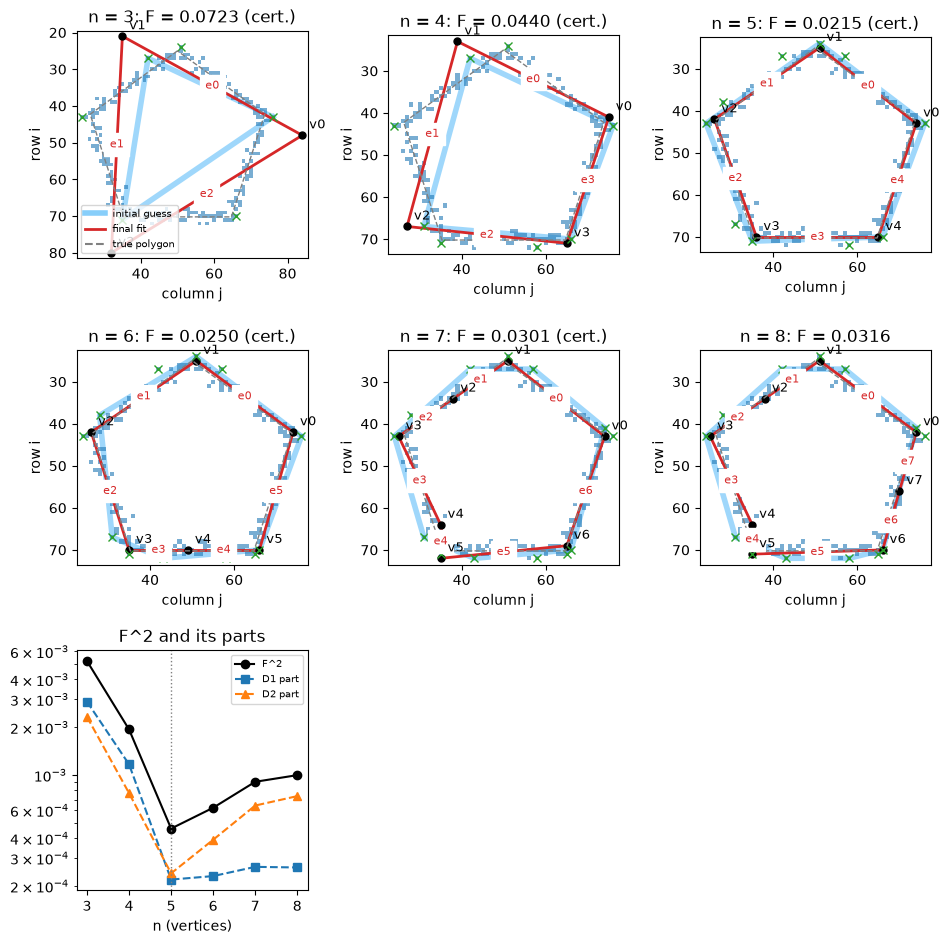

# polyfit-lean

Best-fit polygons for sets of pixels, with the solver written in **Lean 4** and driven from **Python**.

Given points on a pixel grid, polyfit-lean finds the polygon with *n* vertices (a point, a segment, a triangle, …) that best fits them. Some of the polygon's edges can be declared *missing*, for shapes that are open on one side. Every score is computed in **exact rational arithmetic**. Each result can be **certified**: an exhaustive check shows that no nearby polygon scores better. Formal Lean proofs of the algorithm's guarantees are the next stage of the project.



*Fits to a noisy pentagon outline of 223 points, with n = 3 … 8. Light blue: the coarse initial guess. Red: the refined fit. The objective (last panel) is lowest at the true n = 5, where its two parts balance.*

## The objective

For points $P$ and a polygon $Q$ with present edges $\ell_i$, let $d_1(x, A) = \inf_{a \in A} |x - a|$. Two scale-invariant terms are combined:

- **Points to polygon:** $D_1(P, Q)^2 = \dfrac{1}{\mathrm{diam}(P)^2}\,\dfrac{1}{|P|}\sum_{p \in P} d_1(p, Q)^2$
- **Polygon to points**, for each edge: $D_2(\ell, P)^2 = \dfrac{1}{L(\ell)^2}\displaystyle\int_0^1 d_1(q_0 + t(q_1 - q_0), P)^2\,dt$

and

$$F(Q)^2 = \tfrac12 D_1(P, Q)^2 + \frac{1}{2m}\sum_{i \notin M} D_2(\ell_i, P)^2 ,$$

where $M$ is the set of missing edges and $m$ the number of present ones. This is a two-sided, mean-square relative of the Hausdorff distance. $D_1$ makes the polygon pass near the points, and $D_2$ keeps its edges from running through empty space or past the ends of the data.

**Exactness.** Polygon vertices are integer points, so every quantity is rational. In particular, along an edge every $|q(t) - p|^2$ is a quadratic in $t$ with the *same* $t^2$ coefficient. So $\min_p |q(t)-p|^2$ is a fixed quadratic plus the lower envelope of straight lines, and its integral is computed exactly by walking the envelope. No floating point is used anywhere in the solver.

The full specification and the design decisions are in [docs/spec.md](docs/spec.md).

## How a fit works

1. **Describe** the point set: exact centre of mass, diameter, radii, and convex hull.
2. **Reduce the hull** to at most $2n$ candidate vertices (Visvalingam–Whyatt).
3. **Rough fit:** score every cyclically ordered $n$-subset of the candidates (and every labelling of the edges, when edges are missing) and keep the best $K$. Scoring is pruned exactly: a candidate is abandoned as soon as it provably cannot make the top $K$.
4. **Fine fit:** a pattern search with a move set that grows linearly in $n$.
5. **Ultra-fine fit:** check *all* $9^n - 1$ polygons in the unit cube around the result (every vertex moved by at most one pixel in each coordinate). If none is better, the result is **certified** as a local minimum. Whole-number lower bounds screen candidates exactly, which makes this practical up to $n = 7$.

Python controls this pipeline step by step and records every attempt: the rough fits, the final polygon and its exact $F^2$, whether it is certified, and timings. Saved results are re-verified on loading by replaying each step in Lean.

## Repository layout

| Path | Contents |
|---|---|
| [`lean/PolyFit/`](lean/PolyFit) | The Lean 4 solver: geometry, exact objective, hull, rough fit, local search, JSON protocol |
| [`polyfit/`](polyfit) | The Python package: point sets and fit attempts, the bridge to Lean, plotting, an independent exact reference implementation |
| [`tests/`](tests) | About 500 tests, most checking Lean's results exactly against the Python reference |
| [`notebooks/explore.ipynb`](notebooks/explore.ipynb) | Experiments: sample shapes, random points, an annulus, dense noisy outlines |
| [`docs/spec.md`](docs/spec.md) | The specification, decisions, and the plan for the proofs |

## Getting started

Requirements: [elan](https://github.com/leanprover/elan) (Lean 4, version pinned in `lean/lean-toolchain`) and Python 3.11 or later.

```bash
# build the Lean solver
cd lean
lake build
cd ..

# install the Python package and run the tests
python -m venv .venv
.venv/Scripts/python -m pip install -e ".[dev]"     # on Linux/macOS: .venv/bin/python
.venv/Scripts/python -m pytest
```

```python
import polyfit
from polyfit import samples

ps = polyfit.PointSet.from_points(samples.hexagon_outline())
attempt = ps.fit(n_vertices=6)
attempt.vertices, attempt.objective_sq, attempt.certified
```

## Status

- Working: fits for every n, missing edges, certification up to n = 7, recorded and re-verifiable attempts.
- Next: formal Lean proofs, in a separate project that uses Mathlib. The first target is the n = 1 case (the rounded centre of mass is optimal). After that: the certificate theorem (a certified result really is a local minimum of the computed objective), and that the computed objective equals the mathematical definition above.
- Ideas for later: faster local search for very large point sets, and branch and bound for certification at larger n.

## How it was built

The problem, the objective function, and the design decisions are by the author. The implementation was developed together with [Claude Code](https://claude.com/claude-code), Anthropic's AI coding assistant, working step by step from the specification in [docs/spec.md](docs/spec.md). Every Lean component is tested against an independent exact Python reference.

## License

[MIT](LICENSE)
